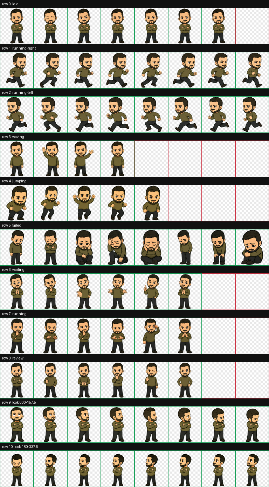

<div align="center">


# Zelenskyy Codex Pet

A determined chibi statesman for the Codex desktop app.

[](#animation-gallery)
[](spritesheet.webp)
[](LICENSE)
[](ASSETS-LICENSE.md)

</div>

Zelenskyy is an unofficial, fan-made custom pet inspired by Volodymyr Zelenskyy, wearing a plain olive-green crewneck. The package includes the complete Codex v2 animation set: standard actions plus 16 clockwise look directions.

> [!IMPORTANT]
> This project is not affiliated with or endorsed by Volodymyr Zelenskyy, the Office of the President of Ukraine, OpenAI, or GitHub. See the full [disclaimer](DISCLAIMER.md).

## Install

### Windows PowerShell

```powershell
irm https://raw.githubusercontent.com/kapustazh/zelenskyy-codex-pet/main/install.ps1 | iex
```

### macOS or Linux

```bash
curl -fsSL --proto '=https' --tlsv1.2 https://raw.githubusercontent.com/kapustazh/zelenskyy-codex-pet/main/install.sh | sh
```

The installer safely stages both files, replaces an older `zelenskyy` package only after the download passes basic checks, and rolls back if activation fails.

After installation, restart Codex and choose **Zelenskyy** in **Settings → Pets**.

### Manual installation

1. Download [`pet.json`](pet.json) and [`spritesheet.webp`](spritesheet.webp).
2. Create the pet directory:
   - Windows: `%USERPROFILE%\.codex\pets\zelenskyy\`
   - macOS/Linux: `~/.codex/pets/zelenskyy/`
3. Put both files directly in that directory.
4. Restart Codex and select **Zelenskyy** in **Settings → Pets**.

If `CODEX_HOME` is set, use `$CODEX_HOME/pets/zelenskyy/` instead.

## Animation gallery

| Thinking / working | Speaking / asking |
|:---:|:---:|
|  |  |
| Waving | Reviewing |
|  |  |
| Running | Jumping |
|  |  |
| Recovering from failure | Looking around |
|  |  |

<details>
<summary>View the complete 11-row animation atlas</summary>



</details>

## Package format

```text
zelenskyy/
├── pet.json
└── spritesheet.webp
```

- Format: Codex pet v2
- Atlas: `1536×2288` WebP with transparency
- Grid: 8 columns × 11 rows
- Cell size: `192×208`
- Standard actions: idle, move right, move left, wave, jump, fail, wait, work, and review
- Directional actions: 16 clockwise look poses

## Validate or regenerate previews

Python 3 and [Pillow](https://pillow.readthedocs.io/) are required:

```bash
python -m pip install Pillow
python scripts/validate_pet.py
python scripts/generate_previews.py
```

The validation also runs automatically on GitHub Actions.

## Credits and licenses

The packaging format and installation approach were inspired by [Awesome Codex Pet](https://github.com/legeling/awesome-codex-pet).

- Installer, validation, and documentation code: [MIT](LICENSE)
- Spritesheet and generated previews: [CC BY-NC 4.0](ASSETS-LICENSE.md)

